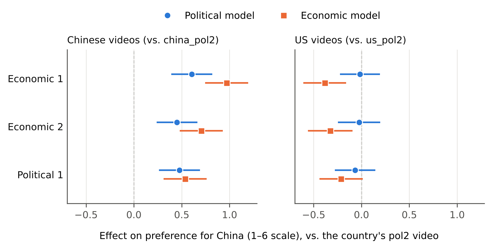

# Which Messages Persuade? Unbundling the Effects of Chinese State Media

A replication and extension of Mattingly et al. (2025)

**Paper:** [`paper/main.pdf`](paper/main.pdf)
**Author:** Yuxuan Zhang, Harris School of Public Policy, University of Chicago

> Mattingly, Daniel C., Trevor Incerti, Changwook Ju, Colin Moreshead, Seiki Tanaka, and Hikaru Yamagishi. 2025. "Chinese State Media Persuades a Global Audience That the 'China Model' Is Superior: Evidence from a 19-Country Experiment." *American Journal of Political Science* 69(3): 1029–46. https://doi.org/10.1111/ajps.12887

The original analysis was written in R. This project reproduces the main results in Python and extends them by *unbundling the treatments*: within each treatment arm, the specific videos a respondent saw were also randomly assigned, which allows causal comparisons of individual messages that the published paper does not report.

## Suggested code review path

For a short coding-sample review, start with:

1. [`src/replicate.py`](src/replicate.py): translation of the authors' primary R models into Python, including a check against all 24 reported coefficients and standard errors.
2. [`src/message_effects.py`](src/message_effects.py): this project's extension—recover the within-arm assignment structure, estimate individual-video effects, and compare content using explicit linear contrasts and bootstrap uncertainty.
3. [`src/diagnostics.py`](src/diagnostics.py): supporting balance and missingness checks, with convergence checks for the multinomial models.

The original experiment, cleaned data, primary model specification, and the pooled video-type regression come from Mattingly et al. The message-level comparisons, companion and position analyses, dispersion comparisons, and perception-index sensitivity checks are additions in this project. [`src/mechanisms.py`](src/mechanisms.py) contains the exploratory perception analyses; these estimate effects on perceptions, not causal mediation.

## Main findings

- **Replication.** All 24 coefficients, standard errors, and sample sizes in the original primary results table (Mattingly et al.'s Table A3) match the published values at two decimals.
- **Individual messages differ.** Among respondents who saw a single CGTN video, the most and least persuasive of the four videos differ by 0.60 points on preference for China's political model and 0.97 points on its economic model (six-point scales), more than the overall effects of that arm (0.36 and 0.28).
- **Economic content compares well.** In two independent designs, economic CGTN videos are not detectably less persuasive than the stronger political video about China's political model, and they are more persuasive about its economic model (by 0.26 and 0.30 points).
- **The design as implemented.** Every respondent in the China arm saw the same political video, `china_pol2`, which was the least persuasive of the four CGTN videos in the Competition arm.



*Figure 2 of the paper: effect of each video relative to its country's `pol2` video, among respondents who saw one Chinese and one US video. Lines are pointwise 95% confidence intervals.*

## Data

The data are not included in this repository. Download the authors' replication package from Harvard Dataverse (https://doi.org/10.7910/DVN/CQ4FZR) and place `clean.RData` from its `Data/` folder at `data/raw/clean.RData`. This is the authors' cleaned analysis file and the only data file the code uses (see Section 3.1 of the paper for why the analysis starts from it rather than the raw survey exports).

## Environment

Python 3.12.

```bash
python3.12 -m venv .venv
source .venv/bin/activate
pip install -r requirements.txt
```

## Running

```bash
python run_all.py
```

The pipeline writes the result tables and figures. Runtime depends on the machine and whether the plotting font cache already exists.

To also check the manuscript's reported numbers:

```bash
python run_all.py --check-paper
```

Or check an existing set of outputs without re-estimating:

```bash
python checks/check_paper.py
```

This auxiliary check rebuilds 177 passages and claims from the outputs and checks them against `paper/main.tex`. It detects inconsistencies between results and manuscript text; it does not independently validate statistical methods. Because some checks match full passages, wording changes may require updating the checker.

Run the focused synthetic tests (no survey data or extra test packages needed):

```bash
python -m unittest discover -s tests -v
```

These cover companion identification, linear-contrast estimates and standard errors, index standardization and complete cases, degenerate index inputs, and rejection of failed multinomial fits.

To rebuild the paper after running the pipeline (requires a LaTeX distribution):

```bash
cd paper && latexmk -pdf main.tex
```

## Repository structure

```
├── run_all.py              # analysis pipeline; --check-paper adds manuscript checks
├── src/
│   ├── clean.py            # load, document, and validate the analysis sample
│   ├── replicate.py        # reproduce the authors' primary models
│   ├── message_effects.py  # assignment, video effects, and content contrasts
│   ├── mechanisms.py       # exploratory perceptions and summary indices
│   ├── diagnostics.py      # balance, missingness, and original-code specification
│   ├── analysis_utils.py   # shared model settings and table helpers
│   └── figures.py          # draw figures from result tables
├── checks/check_paper.py   # optional manuscript consistency checks
├── tests/test_analysis.py  # focused synthetic checks
├── paper/                  # LaTeX source and compiled paper
├── data/                   # not tracked; see Data above
└── output/                 # tables and figures
```

The complete [output catalog](docs/outputs.md) maps generated tables and figures to the paper. Each analysis script can also be run directly after `clean.py`.

## License

The code is released under the [MIT License](LICENSE). The paper (`paper/main.tex` and `paper/main.pdf`) is licensed under [CC BY 4.0](https://creativecommons.org/licenses/by/4.0/). The data belong to Mattingly et al. and are distributed under the terms of their Dataverse replication package; they are not redistributed here.
