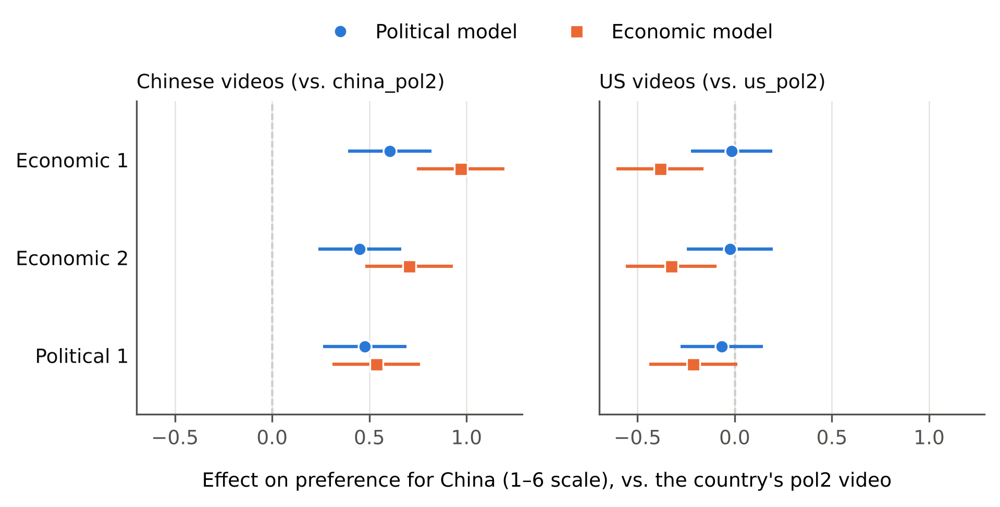

# Which Messages Persuade? Unbundling the Effects of Chinese State Media

[](https://github.com/maeve5ood/mattingly-china-model-replication/actions/workflows/tests.yml)

A replication and extension of Mattingly et al. (2025)

**Paper:** [`paper/main.pdf`](paper/main.pdf)
**Author:** Yuxuan Zhang, Harris School of Public Policy, University of Chicago

> Mattingly, Daniel C., Trevor Incerti, Changwook Ju, Colin Moreshead, Seiki Tanaka, and Hikaru Yamagishi. 2025. "Chinese State Media Persuades a Global Audience That the 'China Model' Is Superior: Evidence from a 19-Country Experiment." *American Journal of Political Science* 69(3): 1029–46. https://doi.org/10.1111/ajps.12887

The experiment and the cleaned data are Mattingly et al.'s; their analysis is in R. I port their primary models to Python and match the 24 coefficients and standard errors in their Table A3 to the reported precision, along with the sample sizes. The extension uses something the published paper leaves aside: within each treatment arm, the specific videos a respondent saw were also randomized. I recover the rule behind that assignment from the data and use it to compare individual messages.

## Findings

Among respondents who saw a single CGTN video, the most and least persuasive of the four differ by 0.60 points on preference for China's political model and 0.97 on its economic model (six-point scales), more than the Competition arm's overall effects (0.36 and 0.28). Compared with `china_pol1`, the economic videos increase preference for China's economic model by 0.26 and 0.30 points in two independent designs. The corresponding differences on the political outcome are statistically inconclusive. Every respondent in the China arm saw the same political video, `china_pol2`, which was the weakest of the four in the Competition arm.



*Figure 2 of the paper: effect of each video relative to its country's `pol2` video, among respondents who saw one Chinese and one US video. Lines are pointwise 95% confidence intervals.*

## Where to start reading the code

1. [`src/02_replicate.py`](src/02_replicate.py): the authors' primary models, with `compare_with_paper` checking every cell of Table A3.
2. [`src/03_message_effects.py`](src/03_message_effects.py): the extension. `assignment_table` and `add_companion` recover the within-arm design, `content_contrasts` compares content across the two designs, and `range_uncertainty` and `dispersion_comparison` are the parametric bootstraps.

Shared helpers are in [`src/analysis_utils.py`](src/analysis_utils.py). [`src/05_diagnostics.py`](src/05_diagnostics.py) has the balance and missingness checks, and [`src/04_mechanisms.py`](src/04_mechanisms.py) the exploratory perception results (effects on perceptions, not mediation).

## Data

The data are not in this repository. Download the authors' replication package from Harvard Dataverse (https://doi.org/10.7910/DVN/CQ4FZR) and put `clean.RData` from its `Data/` folder at `data/raw/clean.RData`. It is the authors' cleaned analysis file and the only data file the code reads; Section 3.1 of the paper explains why the analysis starts there rather than from the raw survey exports.

## Running

Python 3.12:

```bash
python3.12 -m venv .venv
source .venv/bin/activate
pip install -r requirements.txt
```

Then:

```bash
python run_all.py
```

The pipeline writes tables to `output/tables/` and figures to `output/figures/`. It also generates `paper/numbers.tex` from the result tables. The manuscript uses `\val{...}` to insert estimates and table rows. CI regenerates this file from the committed tables and compiles the paper.

The unit tests use synthetic data:

```bash
python -m unittest discover -s tests -v
```

To rebuild the paper (needs LaTeX):

```bash
cd paper && latexmk -pdf main.tex
```

## Repository structure

```
├── run_all.py                 # runs steps 1-7
├── src/
│   ├── 01_clean.py            # load and validate the analysis sample
│   ├── 02_replicate.py        # the authors' primary models
│   ├── 03_message_effects.py  # assignment, video effects, content contrasts
│   ├── 04_mechanisms.py       # exploratory perceptions and indices
│   ├── 05_diagnostics.py      # balance, missingness, the authors' video-type regression
│   ├── 06_figures.py          # figures from the result tables
│   ├── 07_paper_numbers.py    # numbers for the paper, from the result tables
│   └── analysis_utils.py      # shared model settings and helpers
├── tests/test_analysis.py
├── paper/                     # LaTeX source, generated numbers, compiled paper
├── data/                      # not tracked; see Data
└── output/                    # tables and figures
```

Steps 2–5 read the cleaned data from step 1. Steps 6 and 7 use the resulting CSVs.

## License

Code: [MIT](LICENSE). Paper (`paper/main.tex`, `paper/main.pdf`): [CC BY 4.0](https://creativecommons.org/licenses/by/4.0/). The data belong to Mattingly et al. and are distributed under the terms of their Dataverse package; they are not redistributed here.
